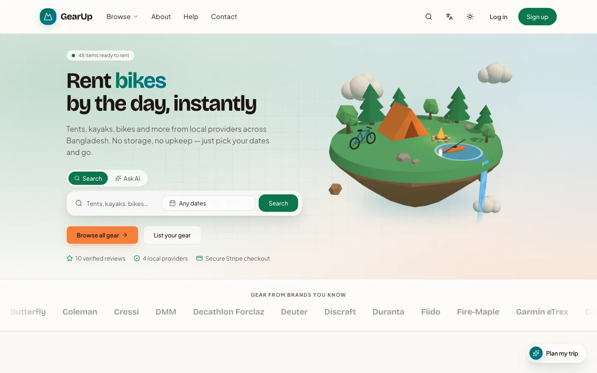
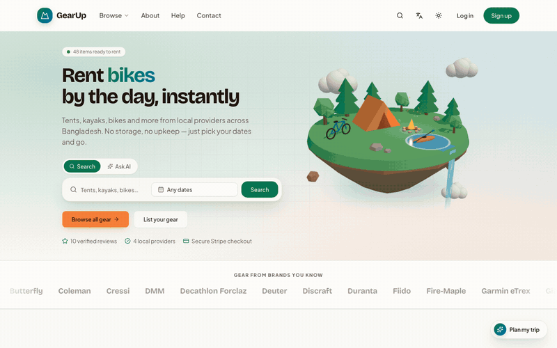
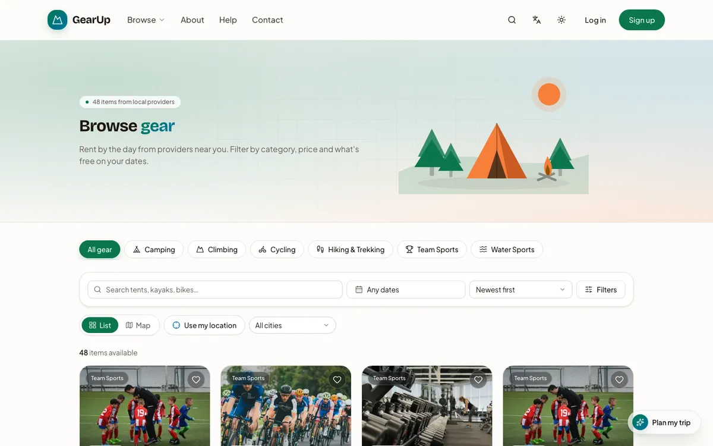
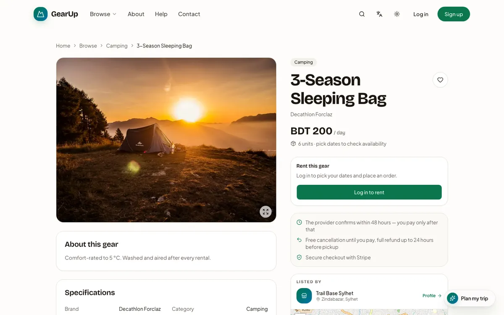
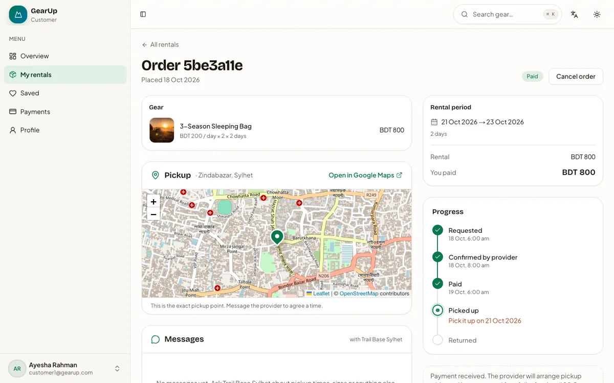
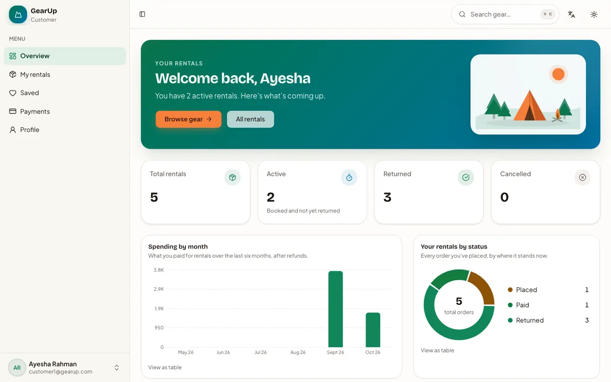
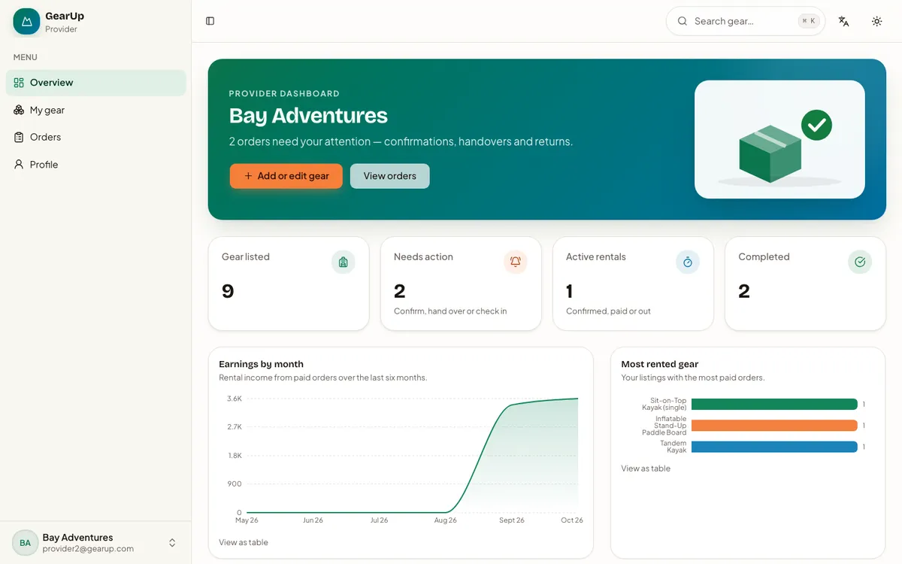
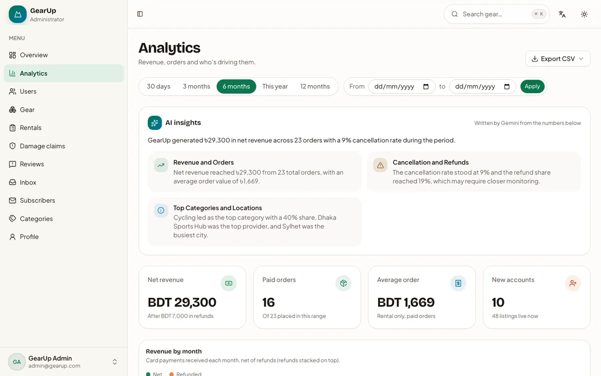
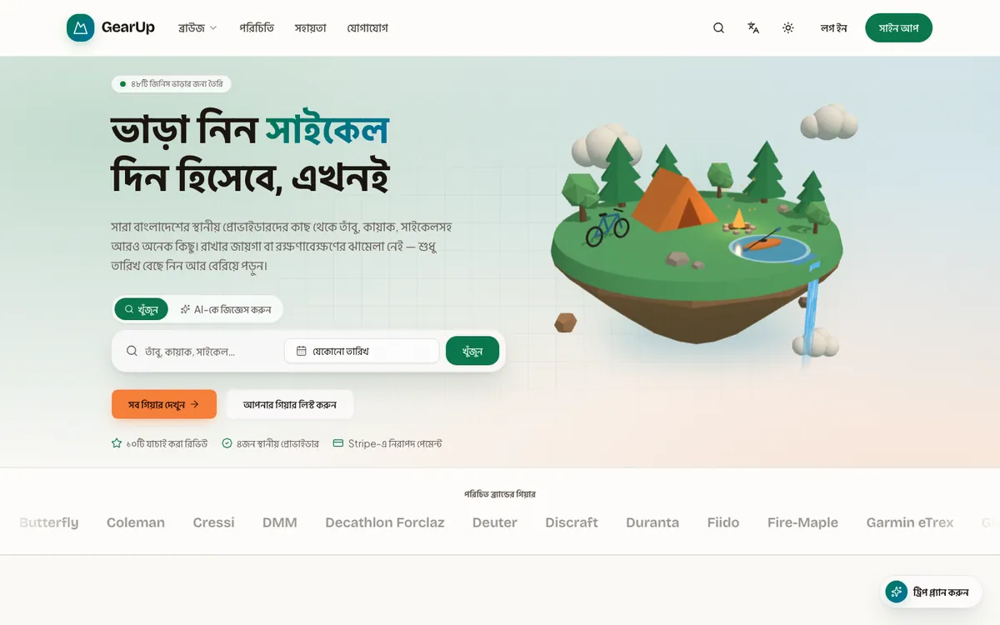
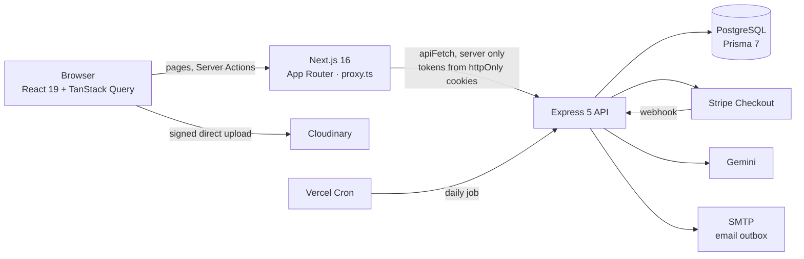

<div align="center">

# GearUp

**Rent sports and outdoor gear by the day, from people near you.**

Tents, kayaks, bikes and cameras from local providers across Bangladesh: live availability for your dates, Stripe payments with deposits, chat with the owner and an AI trip planner. In English and Bangla.

[](https://gear-up-frontend-chi.vercel.app/)
[](https://gear-up-backend-two.vercel.app/)
[](https://github.com/abdullahmamun1/gearup-backend-api)


<picture>
  <source media="(prefers-color-scheme: dark)" srcset="docs/readme/home-dark.webp">
  
</picture>

</div>

This is the website. The REST API lives in [gearup-backend-api](https://github.com/abdullahmamun1/gearup-backend-api).

## Table of contents

- [Why GearUp](#why-gearup)
- [Product tour](#product-tour)
- [Features](#features)
- [AI features](#ai-features)
- [Architecture](#architecture)
- [Tech stack](#tech-stack)
- [Guided installation](#guided-installation)
- [Troubleshooting](#troubleshooting)
- [Demo accounts](#demo-accounts)
- [Scripts](#scripts)
- [Project structure](#project-structure)
- [Deployment](#deployment)
- [Roadmap and known gaps](#roadmap-and-known-gaps)
- [Author](#author)

## Why GearUp

**For renters**

| The problem | How GearUp solves it |
|---|---|
| Good gear is expensive, and most people use a tent or kayak a few times a year | Rent it by the day from people nearby, from ৳65 an order |
| You can't tell whether gear is free on your dates without messaging the owner | Pick dates and see only gear that is free on every day. Each gear page shows availability day by day |
| Listings are far away or vague about where they are | Filter by city or "near me" with a radius, or browse on a map, nearest first |
| You don't know what to pack | The AI trip planner asks about the trip and suggests real gear that is free on your dates |
| A search like "camping stuff" returns a mess | AI search suggestions turn it into precise searches, such as "2-person tent in Sylhet" |
| Reading dozens of reviews takes too long | Each gear page sums up the reviews in a short verdict with pros and cons |
| Arranging pickup over phone calls is messy | Every order has a chat with the provider, a pickup map once paid and a reminder email the day before |
| Many sites are English only | The whole site, every email and the AI replies work in Bangla, with Bengali digits |

**For gear owners**

| The problem | How GearUp solves it |
|---|---|
| Expensive gear sits unused most of the year | List it in minutes and earn per day. The home page calculator estimates earnings first |
| Writing a good listing and choosing a price is hard | The AI listing writer drafts the description and highlights and suggests a fair price for the category |
| The same item gets promised to two people | Stock is counted per day across all bookings, and simultaneous bookings take turns, so nothing is overbooked |
| Gear comes back damaged | A deposit is charged with the payment. On return the owner releases it or reports damage, and an admin settles the claim |
| Renters book and disappear | A booking holds the gear only until its deadline: unpaid 24 hours after confirmation, it is cancelled and freed |

**Trust between strangers**

| The problem | How GearUp solves it |
|---|---|
| Paying a stranger up front is risky | Payment goes through Stripe, and only after the owner confirms |
| Plans change | Free cancellation before payment, and a full automatic refund until 24 hours before the start day |
| Owners don't reply | Owners have 48 hours to respond, or the request is cancelled. Their response time shows on their profile |
| Fake reviews | Only a renter whose order was returned can review it, once. Admins can hide abusive reviews |
| Sharing a home address with strangers | Before payment, renters see an area of about 1 km. The exact pickup point appears once paid |

**Running the marketplace**

| The problem | How GearUp solves it |
|---|---|
| Damage disputes | A claims queue where an admin keeps all, part or none of the deposit, refunded through Stripe |
| Support messages pile up | An inbox with AI-drafted answers based on the rental policy. An admin always sends |
| No clear view of the business | Analytics by date range, AI insights that explain the changes, and CSV exports |
| Slow phones and patchy data | Prerendered pages, an installable app and an offline page |

## Product tour

<div align="center">
  
</div>

Every screenshot comes from the seeded demo data. GitHub shows the dark version when your theme is dark.

| Browse gear | Gear page |
|---|---|
| <picture><source media="(prefers-color-scheme: dark)" srcset="docs/readme/tour/gear-browse-dark.webp"></picture> | <picture><source media="(prefers-color-scheme: dark)" srcset="docs/readme/tour/gear-detail-dark.webp"></picture> |
| **Order with pickup map and progress** | **Customer overview** |
| <picture><source media="(prefers-color-scheme: dark)" srcset="docs/readme/tour/customer-order-dark.webp"></picture> | <picture><source media="(prefers-color-scheme: dark)" srcset="docs/readme/tour/customer-overview-dark.webp"></picture> |
| **Provider overview** | **Admin analytics with AI insights** |
| <picture><source media="(prefers-color-scheme: dark)" srcset="docs/readme/tour/provider-overview-dark.webp"></picture> | <picture><source media="(prefers-color-scheme: dark)" srcset="docs/readme/tour/admin-analytics-dark.webp"></picture> |
| **Bangla (`/bn`)** | |
| <picture><source media="(prefers-color-scheme: dark)" srcset="docs/readme/tour/bangla-dark.webp"></picture> | |

## Features

**Everyone**
- Home page with a 3D floating-island hero (a flat illustration on phones), search by gear, dates and city, categories, featured gear, how it works, reviews, an earnings calculator, FAQ and newsletter.
- Browse gear: search, category chips, brand, price, dates and availability filters, sorting, pagination, list or map view and "near me".
- Gear page: photo gallery, availability calendar, price breakdown with deposit, AI review summary, reviews, the provider's area on a map and related gear.
- Provider profiles, a searchable help centre, About, Contact and Privacy pages.
- ⌘K search palette for gear, categories, pages and actions.
- Register, log in, Google sign-in, email verification, forgot and reset password, and one-click demo accounts.
- English and Bangla, light and dark themes, responsive down to 360px, keyboard and screen reader friendly, reduced motion respected, installable as an app.

**Customer**
- Book gear for a date range and pay with Stripe Checkout (rental and deposit together).
- Live order timeline, chat with the provider, the exact pickup point once paid, and cancel with a refund within the policy.
- Overview with spending per month and orders by status, saved gear, payment history and reviews after a return.
- Profile with avatar, language, digits and email preferences.

**Provider**
- List gear with drag-and-drop photo upload, price, stock and deposit. The AI listing writer drafts the text and price.
- Accept or decline requests, mark pickup and return, then release the deposit or report damage.
- Overview with earnings per month and top gear, an order page with chat, and a public profile with a map pin.

**Admin**
- Users (role, suspend), categories, all gear (feature items on the home page) and all rentals, with search, filters and pagination.
- Hide or restore reviews, settle damage claims, answer contact messages from an inbox, and see newsletter subscribers.
- Analytics by date range with charts, AI insights and CSV exports of users, rentals, payments and subscribers.

## AI features

GearUp uses Google Gemini (free tier) on the server. Every AI answer is checked against real data before it reaches the page: unknown gear is dropped, categories are mapped to real ones and prices are kept within the normal range for the category. Names, emails and phone numbers are never sent to the AI. If the AI is unavailable, each feature shows a friendly message, hides itself or falls back to plain rules.

### 1. Trip planner
- A "Plan my trip" button on every public page, plus the hero's **Ask AI** tab and the ⌘K palette.
- Describe the trip ("3 days camping in Sylhet for two") and get a short plan with real gear cards that are free on your dates.
- The conversation stays in the browser tab, and replies render as plain text only.

### 2. Search suggestions
- "Try:" chips under the `/gear` filters turn a vague search into precise ones: a category, a city or a price limit.
- Suggestions use only real categories, real provider cities and words from the catalogue. They are cached for 10 minutes.

### 3. Listing writer
- In the provider's gear form: give a name, a few notes and optionally a photo, and get a description, highlights, a category and a suggested price with the reason.
- It fills the form and highlights what changed. Nothing is saved until the provider saves.

### 4. Review summaries
- Once an item has 3 or more reviews, the gear page shows "What renters say": a short verdict with pros and cons.
- It refreshes when new reviews arrive, and in the daily job.

### 5. Admin insights and inbox drafts
- **Insights:** the analytics page compares the chosen range with the one before it. Rules find the signals (revenue up or down 25%, a cancellation spike, refunds of 20% or more, one category dominating, sign-up growth), and the AI explains them in plain language. Without the AI, the rule-based text is shown.
- **Inbox drafts:** "Draft with AI" writes a reply to a contact message from the rental policy only. An admin reads, edits and sends it.

## Architecture



- **Server-only API calls:** the browser never calls the API. Server Components, Server Actions and route handlers call it through `apiFetch` (`src/lib/apiClient.ts`), which never throws and always returns `{ success, statusCode, message, data }`.
- **Tokens never reach JavaScript:** the API returns the tokens, and the site keeps them in httpOnly cookies. No variable uses `NEXT_PUBLIC_`.
- **Route guard:** `src/proxy.ts` checks the token on each request, refreshes it silently, keeps each role inside `/dashboard/<role>` and handles the `/bn` language prefix.
- **Static first:** every public page is prerendered for both languages. Gear and provider pages refresh in the background every 5 minutes. Signed-in details load in small client components after the page appears.
- **Two caches:** public reads use the Next.js Data Cache. Dashboard tables use TanStack Query with the first page rendered on the server. Every write is a Server Action that refreshes both.
- **URL state:** search, filters, tabs and pages live in the query string, so refresh, back and shared links all work.

## Tech stack

| Area | Choice |
|---|---|
| Framework | Next.js 16.4 (App Router, Server Components, Server Actions), React 19, TypeScript |
| Styling | Tailwind CSS v4 (OKLCH tokens), shadcn/ui on Base UI, next-themes |
| Languages | next-intl 4 (English at `/`, Bangla at `/bn`) |
| Motion and 3D | Motion, Embla Carousel, React View Transitions, three.js with React Three Fiber (lazy-loaded, paused off screen) |
| Server state | TanStack Query 5 and the Next.js Data Cache |
| Forms | react-hook-form with Zod 4 |
| Maps and charts | Leaflet with OpenStreetMap, Recharts |
| Other | cmdk, sonner, dnd-kit, Cloudinary uploads, Vercel Analytics |
| Tooling | npm, ESLint, Prettier |

## Guided installation

You run two apps side by side: the API on port 5000 and this website on port 3000. Every step ends with a ✅ check.

### 1. Prerequisites

```bash
node -v      # v20 or newer
npm -v
git --version
```

✅ All three print a version.

### 2. Clone both repos side by side

```bash
mkdir gearup && cd gearup
git clone https://github.com/abdullahmamun1/gearup-backend-api.git
git clone https://github.com/abdullahmamun1/gearUp-frontend.git
```

✅ `ls` shows `gearup-backend-api` and `gearUp-frontend`.

### 3. Start the API

Follow the backend's [guided installation](https://github.com/abdullahmamun1/gearup-backend-api#guided-installation). It walks through the database, Stripe, Google, email, Gemini and Cloudinary, then the demo seed.

✅ `curl http://localhost:5000` prints `GearUp API is running`.

### 4. Configure the website

```bash
cd gearUp-frontend
npm install
cp .env.example .env
```

| Variable | Value for local development |
|---|---|
| `BACKEND_API_URL` | `http://localhost:5000` |
| `JWT_ACCESS_SECRET`, `JWT_REFRESH_SECRET` | Copy them from the API's `.env`. They must match exactly |
| `GOOGLE_CLIENT_ID` | The same client ID the API uses. Without it, Google sign-in returns to the login page with an error |
| `APP_URL` | Optional. Pins the Google redirect URI to `APP_URL/api/auth/google/callback` |
| `SITE_URL` | Optional. The public origin for canonical URLs, the sitemap and share images |

✅ `.env` exists, `BACKEND_API_URL` points at the running API, and both JWT secrets match it.

### 5. Run it

```bash
npm run dev
```

✅ Open http://localhost:3000/login, click the **Customer** demo button, then **Log in**. You land on the customer dashboard with demo orders.

### 6. Optional: Google sign-in

In Google Cloud Console, open **APIs & Services → Credentials**, edit the OAuth client and add this authorised redirect URI. It must match character for character:

```
http://localhost:3000/api/auth/google/callback
```

✅ **Continue with Google** on the login page signs you in.

### 7. Optional: payments

With `stripe listen` running for the API (see the backend README), book an item and pay with the test card `4242 4242 4242 4242`, any future date and any CVC.

✅ The order page shows **Paid** within a few seconds of returning from Stripe.

## Troubleshooting

| Symptom | Fix |
|---|---|
| Login succeeds but lands on the home page, signed out | `JWT_ACCESS_SECRET` or `JWT_REFRESH_SECRET` is missing or differs from the API's. Copy both exactly, then restart or redeploy. The server log says "access token failed verification" |
| `Error 400: redirect_uri_mismatch` from Google | Add `<your origin>/api/auth/google/callback` to the OAuth client exactly, or set `APP_URL` to the origin you registered |
| Pages show empty states after a build | The build couldn't reach `BACKEND_API_URL`. Start the API first, or wait 5 minutes for the pages to refresh |
| Port 5000 is already in use (macOS) | AirPlay Receiver uses it. Set `PORT=3114` in the API's `.env` and `BACKEND_API_URL=http://localhost:3114` here |
| Photo upload says uploads aren't set up | The API needs the three `CLOUDINARY_*` variables |
| The trip planner or AI chips never answer | The API needs `GEMINI_API_KEY`. On slow networks, start the API with `NODE_OPTIONS=--no-network-family-autoselection` |
| An order stays **Confirmed** after paying | Only the Stripe webhook marks it paid. Run `stripe listen` and copy its `whsec_…` into the API's `STRIPE_WEBHOOK_SECRET` |
| `MISSING_MESSAGE` in the browser console | A client component uses text its route group doesn't send. Add the namespace to `CLIENT_MESSAGES` in `src/i18n/pickMessages.ts` |
| A public page shows `ƒ` (dynamic) in the build output | It started reading cookies, headers or query strings on the server. Move that into a client component |
| Hydration error #418 | A signed-in or browser-only value was rendered before hydration. Read it after mount (`useHydrated`) |

## Demo accounts

The login page has one-click buttons for the first three. Every password is `Password123`.

| Role | Email |
|---|---|
| Customer | customer1@gearup.com |
| Provider | provider2@gearup.com |
| Admin | admin@gearup.com |
| More providers | provider1@gearup.com … provider4@gearup.com |
| More customers | customer1@gearup.com … customer5@gearup.com |

## Scripts

```bash
npm run dev              # development server, http://localhost:3000
npm run build            # production build
npm run start            # serve the build
npm run lint             # ESLint
npm run typecheck        # tsc --noEmit
npm run format           # Prettier
npm run check:messages   # every English text key exists in Bangla, with the same placeholders
npm run check:contrast   # WCAG AA contrast of every colour pair in both themes
```

## Project structure

```
messages/
├── en/  bn/            UI text, one JSON file per area (common, nav, gear, dashboard, …)
src/
├── app/
│   ├── [locale]/
│   │   ├── (public)/(marketing)/       home, gear, gear/[id], providers/[id], about, help, contact, privacy, newsletter
│   │   ├── (public)/(authentication)/  login, register, forgot and reset password, verify email
│   │   ├── (dashboard)/dashboard/      customer, provider and admin areas
│   │   └── payment-success, payment-cancelled
│   ├── api/            route handlers for TanStack Query, Google OAuth and CSV export
│   └── sitemap, robots, manifest, opengraph-image
├── api/                "use server" functions, one file per backend module
├── components/
│   ├── ui/             shadcn components (Base UI)
│   ├── shared/         GearCard, DataTable, form fields, maps, motion kit, illustrations
│   ├── layout/         Navbar, Footer, DashboardSidebar, CommandPalette
│   └── modules/        feature components by area (marketing, gear, auth, dashboard, customer, provider, admin, ai, orders)
├── hooks/              TanStack Query hooks, session, favourites, unread counts
├── i18n/               routing, navigation, translators, number and date formatting
├── lib/                apiFetch, session, cookies, jwt, site metadata, share images
├── constants/  routes/  utils/  validation/  providers/  types/
└── proxy.ts            auth checks and language routing for every request
public/
└── sw.js  offline.html  icons/
docs/readme/            README screenshots and the product tour
```

## Deployment

1. Import the repo into Vercel (Next.js is detected).
2. Add the variables from step 4. `BACKEND_API_URL` is the deployed API, and the JWT secrets match it exactly.
3. On the API, set `APP_URL` to this site's URL. Stripe's return links and email links are built from it.
4. Add `https://<your-site>/api/auth/google/callback` to the Google OAuth client.
5. Deploy the API first: the build prerenders pages from it.

✅ Log in with a demo account and land on its dashboard, then book an item and pay with the test card. That confirms the secrets, cookies and Stripe webhook all work.

## Roadmap and known gaps

- **No payouts to providers yet.** Payments land in the platform's Stripe account. Paying providers out (Stripe Connect) is the next big step.
- **One provider per order.** Gear from two providers needs two orders.
- **No automated tests or CI yet.** Every change is checked with `lint`, `typecheck`, `check:messages`, `build` and a walkthrough of each role in both languages.
- **Free-tier AI.** Gemini's free quota can run out at busy times. Each AI feature then shows a friendly message, hides itself or falls back to rules.
- **Bangla share images** don't join conjunct letters, because the image renderer doesn't shape Bengali, so their text is kept simple.

## Author

Built by [Abdullah Mamun](https://github.com/abdullahmamun1).
